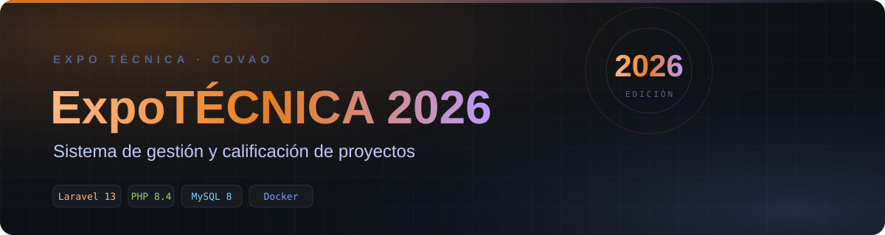

<div align="center">
  
</div>

<h1 align="center">Sistema de Calificación de Proyectos</h1>

<p align="center">
  Plataforma web para registrar, asignar y calificar los proyectos de la <b>ExpoTÉCNICA 2026</b>.
</p>

<p align="center">
  <a href="https://github.com/chava2707/expotecnica-2026/actions/workflows/ci.yml"></a>
  
  
  
  
  
</p>

---

## Descripción

La ExpoTÉCNICA reúne proyectos estudiantiles que deben ser evaluados por un jurado con
rúbricas comunes. Gestionar eso en hojas de cálculo se vuelve lento y propenso a errores.

Este sistema centraliza todo el flujo: registro de proyectos y sus archivos, asignación de
jueces, evaluación en línea con rúbricas ponderadas, cálculo de resultados, generación de PDFs
y notificaciones por correo — con un panel administrativo que muestra el avance en tiempo real.

## Funcionalidades

### 🌐 Público
- Página de inicio con categorías, cantidad de proyectos y porcentaje de avance de la evaluación.
- Ficha pública de cada proyecto con su información y archivos.

### ⚖️ Jueces
- Panel con los proyectos que tiene asignados y su estado.
- Evaluación en línea pregunta por pregunta, con guardado de **borrador** y envío final.
- Consulta de rúbricas y lineamientos de la expo.
- Solicitudes de **edición** (reabrir una evaluación cerrada) y de **ayuda** al administrador.
- Cambio de contraseña y notificaciones por correo al completar una evaluación.

### 🛠️ Administración
- **Dashboard** con métricas y avance de los jueces en tiempo real.
- CRUD de usuarios, proyectos, categorías, ejes temáticos, apartados y preguntas.
- **Asignación** de jueces y suplentes a cada proyecto.
- **Resultados** consolidados y descarga de rúbricas evaluadas en PDF.
- Aprobación o rechazo de solicitudes de edición y ayuda.
- **Avisos de impresión** con enlace firmado enviado por correo.
- Configuración general del evento.

## Stack

| Capa | Tecnología |
| :-- | :-- |
| Backend | Laravel 13 · PHP 8.3+ |
| Vistas | Blade · Bootstrap 5 · Bootstrap Icons |
| Frontend build | Vite · Tailwind CSS 4 |
| Base de datos | MySQL 8 |
| Reportes | DomPDF |
| Correos | Cola de trabajos (`database`) + SMTP |
| Infraestructura | Docker · Docker Compose · Apache |

## Arquitectura

```
                    ┌──────────────┐
   Navegador  ───▶  │  app (Apache)│  :8000
                    │  PHP + Laravel│
                    └──────┬───────┘
                           │
              ┌────────────┼─────────────┐
              ▼            ▼             ▼
        ┌──────────┐  ┌─────────┐  ┌──────────────┐
        │  MySQL 8 │  │  Cola   │  │  Volúmenes   │
        │          │  │ (jobs)  │  │ storage/uploads │
        └──────────┘  └────┬────┘  └──────────────┘
                           │
                    ┌──────▼───────┐
                    │ worker       │  envía correos
                    │ queue:work   │
                    └──────────────┘
```

Los correos se encolan en la tabla `jobs`; el contenedor `worker` los procesa. Sin worker
la aplicación funciona igual, pero las notificaciones quedan pendientes.

## Puesta en marcha con Docker

Requisitos: **Docker Desktop** (con WSL 2 en Windows).

```bash
git clone https://github.com/chava2707/expotecnica-2026.git
cd expotecnica-2026

# 1. Variables de entorno
cp .env.example .env          # Windows: copy .env.example .env

# 2. Edita .env y define al menos MAIL_USERNAME y MAIL_PASSWORD
#    (contraseña de aplicación de Gmail, no tu contraseña normal)

# 3. Levanta los servicios (app, worker y MySQL)
docker compose up -d --build

# 4. Datos iniciales: roles, rúbricas, categorías y usuarios de prueba
docker compose exec app php artisan db:seed --force
```

La aplicación queda en **http://localhost:8000**. La `APP_KEY` se genera sola la primera vez y
se guarda en el volumen de `storage`, así las sesiones sobreviven a los reinicios.

Para detener: `docker compose down` (los datos se conservan en volúmenes).

## Instalación local (sin Docker)

Requisitos: PHP 8.3+, Composer 2, MySQL 8, Node.js 20+.

```bash
composer install
cp .env.example .env
php artisan key:generate

# En .env: DB_HOST=127.0.0.1 y tus credenciales de MySQL
php artisan migrate --seed
php artisan storage:link

npm install && npm run build

# Servidor + cola + Vite en una sola terminal
composer dev
```

Más detalle en [`docs/instalacion.md`](docs/instalacion.md).

## Variables de entorno

Las relevantes están comentadas en [`.env.example`](.env.example). Las que más se tocan:

| Variable | Para qué sirve |
| :-- | :-- |
| `APP_ENV` / `APP_DEBUG` | `production` y `false` en producción |
| `APP_URL` | URL base usada en correos y enlaces firmados |
| `DB_*` | Conexión a MySQL (`DB_HOST=mysql` en Docker, `127.0.0.1` en local) |
| `MAIL_*` | SMTP para las notificaciones (Gmail requiere contraseña de aplicación) |
| `QUEUE_CONNECTION` | `database` en producción; `sync` solo para pruebas |

> **Nunca subas tu `.env`.** Ya está en `.gitignore`. Si una credencial llegó a publicarse,
> rótala: borrar el archivo no la elimina del historial de git.

## Estructura del proyecto

```
app/
  Http/Controllers/     Controladores por módulo (admin, juez, auth)
  Http/Middleware/      AdminMiddleware
  Jobs/                 Envío de correos en cola
  Models/               Eloquent: proyecto, rúbrica, calificación, persona...
database/
  migrations/           Esquema completo
  seeders/              Roles, categorías, rúbricas y datos de prueba
docker/                 entrypoint.sh y configuración de Apache
docs/                   Instalación y despliegue
resources/views/        Blade (público, admin, juez, PDFs, correos)
routes/web.php          Rutas y permisos
tests/                  Pruebas automatizadas
```

## Pruebas y CI

```bash
php artisan test
```

Las pruebas cubren la página pública y el flujo de autenticación (inicio y cierre de sesión,
credenciales inválidas). Cada push a `main` y cada pull request las ejecuta en GitHub Actions
([`.github/workflows/ci.yml`](.github/workflows/ci.yml)).

## Documentación

- [Instalación local paso a paso](docs/instalacion.md)
- [Despliegue con Docker](docs/despliegue.md)

---

<sub>Desarrollado por <a href="https://github.com/chava2707">chava2707</a> · Cartago, Costa Rica · Licencia MIT</sub>
